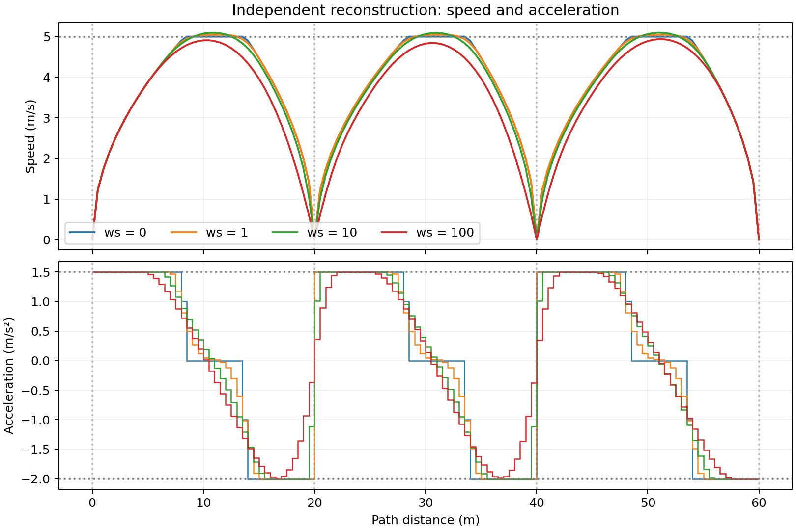
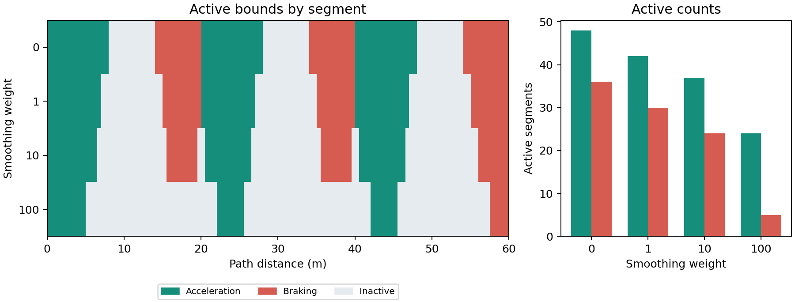
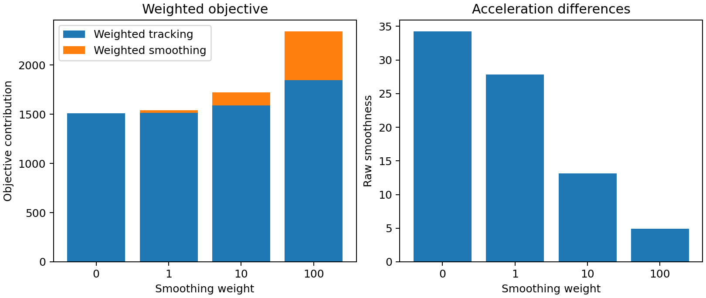

# QP-Based Vehicle Speed Planning

**V1.0 — Research Reconstruction | Fixed-path longitudinal optimization**

A reproducible reconstruction of an October 2026 system optimization course project at National Chi Nan University. The planner computes speed and acceleration along a known path with four mandatory stops, under longitudinal acceleration and speed constraints. This is an offline numerical study, not a real-time controller or a hardware demonstration.



## Reproduction status

- **Original research (October 2026):** MATLAB `quadprog` experiments were reported in the course report and slides. Original source code and raw arrays are lost.
- **Reconstruction (November 2026):** the documented MATLAB formulation is reimplemented in a standalone script. An independent SciPy calculation has actually been executed, with all four solutions certified in the original 241-dimensional space by numerical KKT residuals.
- **Pending:** run the reconstructed MATLAB script using Optimization Toolbox on a licensed MATLAB installation. No MATLAB execution has been performed in the reconstruction environment. Original solver release and unrounded output are unavailable.
- The reported endpoint tracking values are reproduced as **weighted** tracking costs, not raw errors. Original figures and table values are retained as historical evidence; see the [audit](docs/reproduction_audit.md).

## Problem formulation

Given a 60 m path sampled every 0.5 m, define squared speed `beta_i = v_i^2` at 121 nodes and constant acceleration `alpha_i` over 120 segments. Stack them into a 241-element decision vector. The chain rule gives `d(beta)/ds = 2a`, hence

```text
beta[i+1] - beta[i] = 2 * ds * alpha[i]
beta[0] = beta[40] = beta[80] = beta[120] = 0
0 <= beta <= 36;  -2 <= alpha <= 1.5
```

The objective is

```text
E_track  = sum((beta - 25)^2)
E_smooth = sum(diff(alpha)^2)
J        = 0.08 * E_track + ws * E_smooth
ws       = [0, 1, 10, 100]
```

For `quadprog`, `H = 2 * blkdiag(0.08 I, ws D' D)` and `f = [-2*0.08*betaRef; zeros(120,1)]`, where `D` is the 119-by-120 first-difference matrix. The equality matrix is 124-by-241 (rank 124; 364 nonzeros). `H` is positive semidefinite; after eliminating the equality constraints the reduced objective is strictly convex because the tracking weight is positive and acceleration is determined by squared speed. The smoothness term is a spatial acceleration-difference surrogate, **not time-based jerk**.

## Reproduce in MATLAB

Requires MATLAB R2020a or later (for plotting/export), Optimization Toolbox and `quadprog`. Open MATLAB, set Current Folder to the repository root, and run:

```matlab
run('matlab/run_reconstruction.m')
```

The script uses `interior-point-convex`, constraint and optimality tolerances of `1e-9`, and the documented `1e-4` bound-activity tolerance. It saves raw decisions, dual variables, summary, a MAT workspace, environment metadata, and three figures under `results/matlab/`. It compares regenerated metrics to the independent reference and fails explicitly if the audit thresholds are exceeded. No model parameter is tuned to match the report. The independent data are not inputs to the solver.

## Independent verification (optional)

From the repository root with Python 3 and pip:

```bash
python -m pip install -r validation/requirements.txt
python validation/verify.py
```

This uses an equivalent reduced model: eliminate the four fixed beta nodes and the dynamics, solve with SciPy SLSQP, polish the candidate active set with an equality QP solve, then reconstruct the full-dimensional primal and dual certificate. Results are written to `results/independent/`. The script asserts all five feasibility/optimality residuals are below `1e-7`; this is an audit threshold, not a change to solver options in MATLAB.

## Reconstructed numerical results (independent solver)

| ws | Raw tracking | Weighted tracking | Raw smoothness | Active +1.5 | Active -2 | Total active |
|---:|---:|---:|---:|---:|---:|---:|
| 0 | 18898.00 | 1511.84 | 34.2500 | 48 | 36 | 84 |
| 1 | 18912.44 | 1512.99 | 27.8248 | 42 | 30 | 72 |
| 10 | 19877.10 | 1590.17 | 13.1551 | 37 | 24 | 61 |
| 100 | 23091.88 | 1847.35 | 4.9500 | 24 | 5 | 29 |





Across the four cases, larger smoothing weights reduce the raw acceleration-difference penalty while increasing squared-speed tracking error. The endpoint smoothness decrease is 85.55%; active segments decrease from 84 to 29. The weighted total objective is not a directly comparable ranking across different weights.

## KKT verification

The full-space certificate checks equality feasibility, box-bound feasibility, stationarity (`Hx + f + Aeq'nu - lambdaL + lambdaU`), dual nonnegativity and complementary slackness. Maximum observed independent residual is below `3e-11`. Activity is based on geometric proximity to a bound, not strictly positive multipliers. Multipliers at redundant stop/lower-bound constraints need not be unique.

## Repository layout

```text
matlab/run_reconstruction.m          # primary reconstructed MATLAB script
validation/verify.py                 # independently executed verifier
validation/requirements.txt
results/independent/                 # generated numeric CSVs, figures, environment
results/matlab/                      # generated when MATLAB is run
reference/original_report_table3.csv # original endpoint values, unchanged
reference/source_manifest.md         # document provenance
docs/reproduction_audit.md          # discrepancy analysis and acceptance criteria
docs/LEARNING_ZH.md                 # derivations and guided MATLAB exercises
```

## Scope and attribution

The original course project and the reconstructed implementation are distinct. This is a fixed-path, fixed-stop, one-dimensional, convex optimization baseline. It does not model signal timing, steering, moving obstacles, true jerk, energy, minimum travel time or measured comfort. The original report mentions an illustrative animation with a two-second dwell; this reconstruction does not implement that optional animation because the requested baseline concerns the QP experiments. V2.0 extensions are intentionally deferred.

References: Boyd & Vandenberghe (2004), *Convex Optimization*; Lipp & Boyd (2014), *Minimum-time speed optimisation over a fixed path*, DOI: 10.1080/00207179.2013.875224; MathWorks, `quadprog` documentation. Original report and presentation are not redistributed in this package. No license is selected; the owner should choose one before public reuse is granted.
