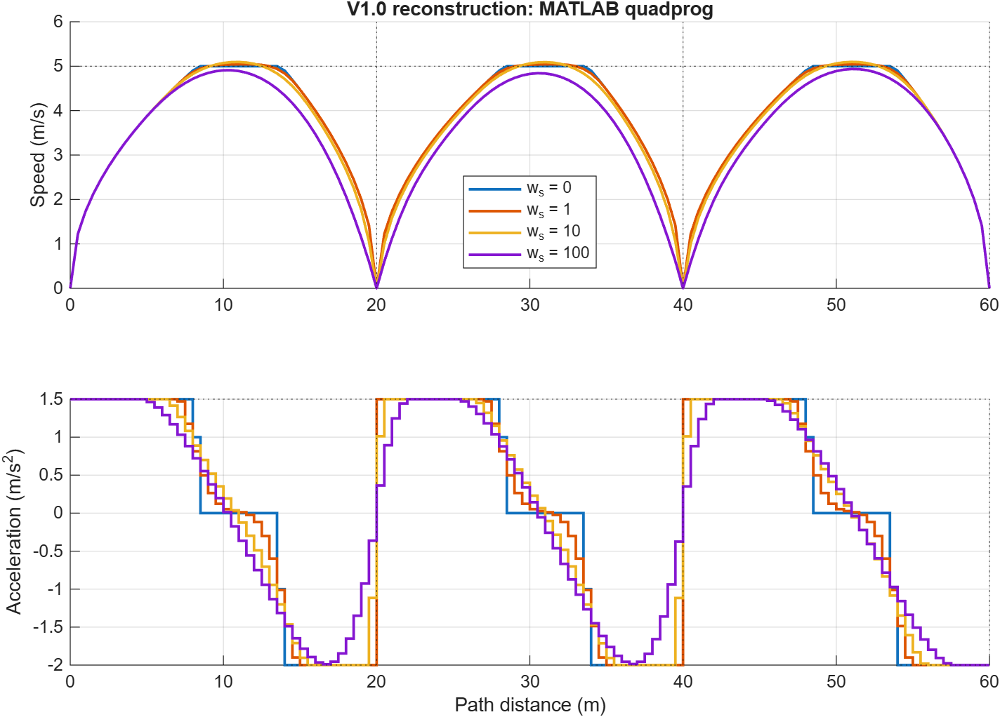
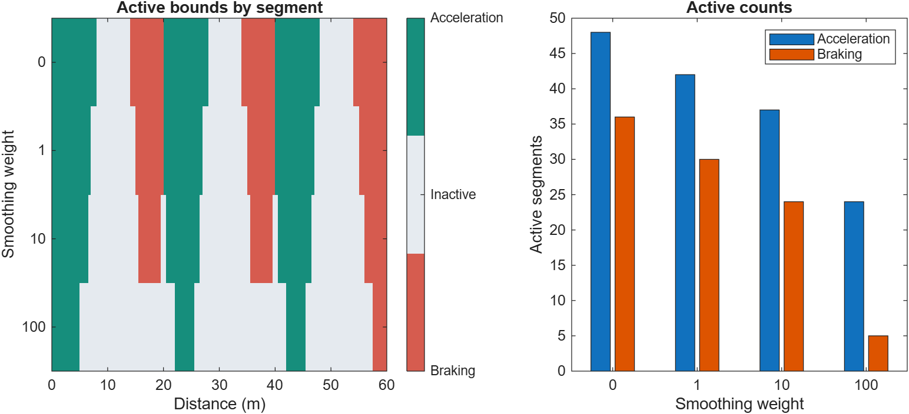
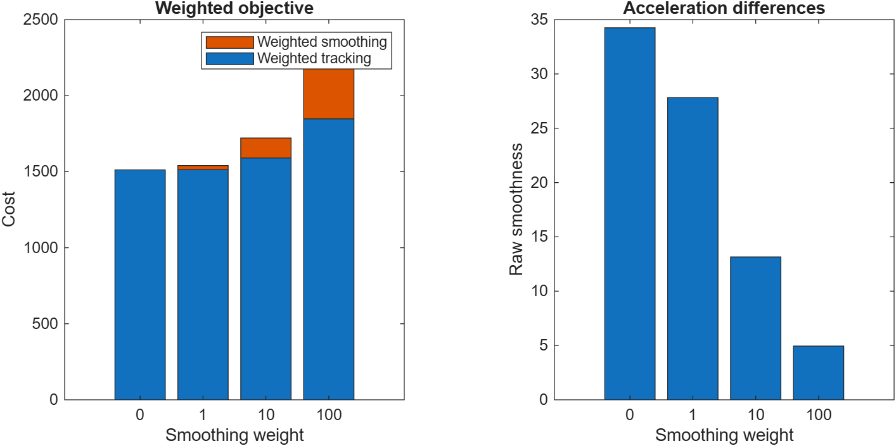

# QP-Based Vehicle Speed Planning


## Project Overview

This project develops a convex Quadratic Programming (QP)
framework for fixed-path vehicle speed planning, balancing
reference speed tracking and acceleration smoothness under
vehicle dynamics and physical constraints.

The optimization model is implemented in MATLAB using
`quadprog` and independently validated using Python and SciPy.

Potential applications include autonomous vehicles,
autonomous mobile robots (AMRs), and longitudinal motion planning.

## Key Achievements

- Formulated a convex QP with 241 decision variables
  and 124 equality constraints.
- Evaluated four acceleration smoothing weight configurations.
- Achieved an 85.55% reduction in acceleration-difference cost.
- Reduced active acceleration and braking segments by 65.48%.
- Verified all four solutions using numerical KKT conditions.
- Successfully cross-validated MATLAB and Python solutions.

## Speed and Acceleration Profiles



## Mathematical Formulation

### 1. Spatial Vehicle Dynamics

The vehicle travels along a predetermined 60 m path
with a spatial discretization interval of 0.5 m.

Using the squared-speed transformation:

$$
\beta_i = v_i^2
$$

The longitudinal vehicle dynamics become:

$$
\frac{d\beta}{ds}=2a
$$

After spatial discretization:

$$
\beta_{i+1}-\beta_i=2\alpha_i\Delta s
$$

This transformation enables the vehicle dynamics
to be represented as linear equality constraints.

### 2. Decision Variables

$$
x=
\begin{bmatrix}
\beta\\
\alpha
\end{bmatrix}
\in\mathbb{R}^{241}
$$

- 121 squared-speed variables.
- 120 acceleration variables.
- 120 vehicle dynamics constraints.
- 4 mandatory stopping constraints.

### 3. Simulation Parameters

| Parameter | Value |
|---|---:|
| Path length | 60 m |
| Spatial resolution | 0.5 m |
| Reference speed | 5 m/s |
| Maximum speed | 6 m/s |
| Maximum acceleration | 1.5 m/s² |
| Minimum acceleration | -2 m/s² |
| Mandatory stops | 0, 20, 40, 60 m |
| Tracking weight | 0.08 |
| Smoothing weights | 0, 1, 10, 100 |

### 4. Objective Function

The optimization objective balances squared-speed
tracking and acceleration smoothness.

$$
E_{\mathrm{track}}
=\sum_{i=0}^{120}(\beta_i-25)^2
$$

$$
E_{\mathrm{smooth}}
=\sum_{i=0}^{118}(\alpha_{i+1}-\alpha_i)^2
$$

$$
\min_x J=0.08E_{\mathrm{track}}
+w_sE_{\mathrm{smooth}}
$$

### 5. Quadratic Programming

The optimization problem is expressed in standard QP form:

$$
\min_x\frac{1}{2}x^THx+f^Tx
$$

Subject to:

$$
A_{\mathrm{eq}}x=b_{\mathrm{eq}}
$$

$$
lb\leq x\leq ub
$$

The Hessian is constructed as:

$$
H=2
\begin{bmatrix}
0.08I&0\\
0&w_sD^TD
\end{bmatrix}
$$

where D is the first-difference matrix for adjacent
acceleration values.

| Matrix | Dimensions |
|---|---:|
| H | 241 × 241 |
| f | 241 × 1 |
| Aeq | 124 × 241 |
| beq | 124 × 1 |
| D | 119 × 120 |

The Hessian is positive semidefinite.
After eliminating the equality constraints,
the reduced objective is strictly convex,
ensuring a unique primal optimum.

## Experimental Results

The following results were obtained using MATLAB `quadprog`.

| Smoothing Weight | Raw Tracking | Weighted Tracking | Raw Smoothness | Active Segments |
|---:|---:|---:|---:|---:|
| 0 | 18898.00 | 1511.84 | 34.2500 | 84 |
| 1 | 18912.44 | 1512.99 | 27.8248 | 72 |
| 10 | 19877.10 | 1590.17 | 13.1551 | 61 |
| 100 | 23091.88 | 1847.35 | 4.9500 | 29 |

### Active Set Analysis



Increasing the smoothing weight reduces the number
of segments operating at the acceleration and braking limits.

| Smoothing Weight | Acceleration Bound | Braking Bound | Total |
|---:|---:|---:|---:|
| 0 | 48 | 36 | 84 |
| 1 | 42 | 30 | 72 |
| 10 | 37 | 24 | 61 |
| 100 | 24 | 5 | 29 |

### Objective Function Analysis



Increasing the smoothing weight results in:

- An 85.55% reduction in acceleration-difference cost.
- A 65.48% reduction in active acceleration and braking segments.
- A 22.19% increase in squared-speed tracking error.

These results demonstrate the trade-off between
reference speed tracking and acceleration smoothness.

The weighted total objective values are not directly
comparable across different smoothing weights.

## KKT Verification

Optimality is evaluated using the
Karush-Kuhn-Tucker (KKT) conditions.

### Stationarity

$$
Hx+f+A_{\mathrm{eq}}^T\nu
-\lambda_L+\lambda_U=0
$$

### Primal Feasibility

$$
A_{\mathrm{eq}}x=b_{\mathrm{eq}}
$$

$$
lb\leq x\leq ub
$$

### Dual Feasibility

$$
\lambda_L\geq0,\quad\lambda_U\geq0
$$

### Complementary Slackness

$$
\lambda_L\odot(x-lb)=0
$$

$$
\lambda_U\odot(ub-x)=0
$$

### Numerical Verification Results

| Smoothing Weight | Maximum KKT Residual | Status |
|---:|---:|---|
| 0 | 6.393e-9 | PASS |
| 1 | 1.288e-9 | PASS |
| 10 | 1.155e-10 | PASS |
| 100 | 2.234e-10 | PASS |

All four solutions satisfy the numerical
KKT acceptance threshold of 1e-7.

## MATLAB-Python Cross-Validation

An equivalent reduced optimization model is independently
solved using SciPy SLSQP, followed by active-set polishing
and full-dimensional KKT verification.

| Validation Metric | Result |
|---|---:|
| Successful MATLAB solutions | 4/4 |
| KKT verification passed | 4/4 |
| Maximum MATLAB KKT residual | 6.393e-9 |
| Maximum Python KKT residual | < 3e-11 |
| Maximum raw tracking difference | 7.023e-7 |
| Maximum weighted tracking difference | 5.619e-8 |
| Maximum raw smoothness difference | 8.961e-8 |
| Active constraint count difference | 0 |
| Physical bound violations | 0 |
| Mandatory stop violations | 0 |

The numerical agreement between the two solvers
supports the correctness of the optimization implementation.

**Project Status: Completed and Verified**

## Installation and Usage

### MATLAB

Requirements:

- MATLAB R2020a or later
- Optimization Toolbox

Clone the repository:

```bash
git clone https://github.com/chenyuru1102-ux/QP-Based-Vehicle-Speed-Planning.git
```

Open MATLAB, navigate to the repository root, and run:

```matlab
run('matlab/run_reconstruction.m')
```

The MATLAB implementation uses:

- Solver: `quadprog`
- Algorithm: `interior-point-convex`
- Optimality tolerance: `1e-9`
- Constraint tolerance: `1e-9`
- Active-bound tolerance: `1e-4`

Generated results are saved in `results/matlab/`.

### Python

Install the required dependencies:

```bash
python -m pip install -r validation/requirements.txt
```

Run the independent numerical verification:

```bash
python validation/verify.py
```

Generated results are saved in `results/independent/`.

## Repository Structure

```text
QP-Based-Vehicle-Speed-Planning/
├── README.md
├── matlab/
│   └── run_reconstruction.m
├── validation/
│   ├── verify.py
│   └── requirements.txt
├── results/
│   ├── matlab/
│   └── independent/
├── reference/
│   ├── original_report_table3.csv
│   └── source_manifest.md
└── docs/
    ├── reproduction_audit.md
    └── LEARNING_ZH.md
```

## Technologies

- MATLAB
- MATLAB Optimization Toolbox
- Python
- SciPy
- NumPy
- Matplotlib
- Convex Optimization
- Quadratic Programming
- Sparse Matrix Computation
- Karush-Kuhn-Tucker Conditions
- Active Set Analysis

## Limitations

- Fixed-path, one-dimensional vehicle motion.
- Predetermined mandatory stopping positions.
- Offline numerical optimization.
- No dynamic obstacle avoidance.
- No explicit travel-time minimization.
- Spatial acceleration-difference penalty rather than
  time-based jerk optimization.
- No physical vehicle testing.

## Future Work

Potential extensions include:

- Curvature-dependent speed constraints.
- Time-based jerk optimization.
- Travel-time optimization.
- Dynamic speed constraints.
- Receding horizon optimization.
- ROS 2 and autonomous mobile robot integration.

These extensions are not implemented in Version 1.0.

## References

1. Boyd, S., & Vandenberghe, L. (2004).
   Convex Optimization. Cambridge University Press.

2. Lipp, T., & Boyd, S. (2014).
   Minimum-time speed optimisation over a fixed path.
   International Journal of Control, 87(6), 1297–1311.
   https://doi.org/10.1080/00207179.2013.875224

3. MathWorks. quadprog — Quadratic Programming.
   https://www.mathworks.com/help/optim/ug/quadprog.html

## Author

**Yu-Ru Chen**

Graduate Student in Electrical Engineering  
National Chi Nan University, Taiwan

Research interests:

- Autonomous Mobile Robots
- Motion Planning
- Vehicle Speed Optimization
- Autonomous Navigation
- Mathematical Optimization
- ROS 2

## Project Information

- Version: 1.0
- Completed: November 2026
- Category: Numerical Optimization and Motion Planning
- Validation: MATLAB and Python

Additional research provenance and reproducibility records
are available in the [technical audit](docs/reproduction_audit.md).

