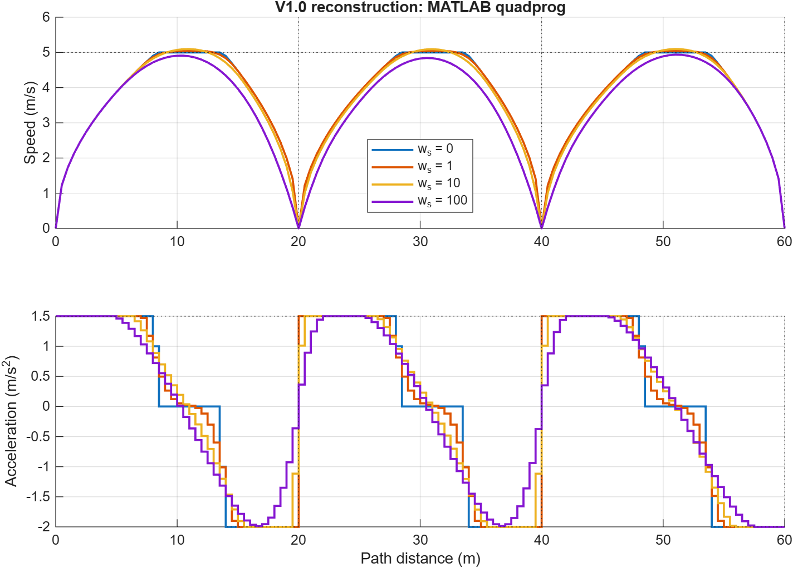
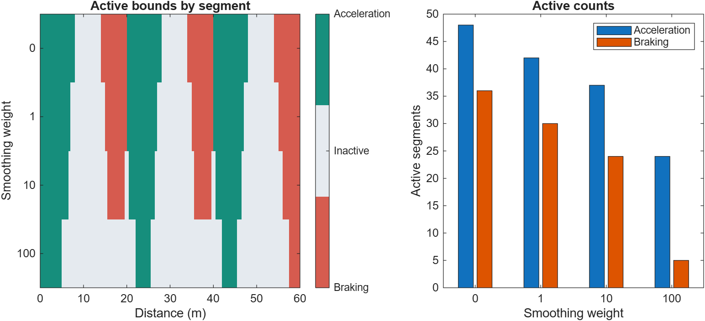
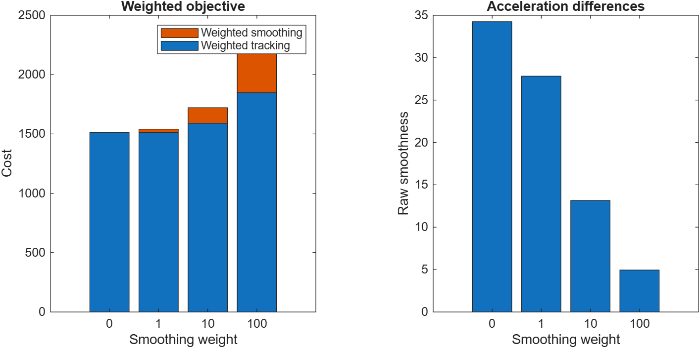

# Numerical Validation Report — V1.0

## 1. Validation Overview

This document presents the mathematical consistency,
numerical accuracy, and cross-solver verification of
the QP-Based Vehicle Speed Planning project.

**Validation Status: Completed and Passed**

- MATLAB optimization: PASS
- Independent Python optimization: PASS
- Structural verification: PASS
- KKT conditions: PASS
- Cross-solver numerical comparison: PASS
- Physical constraint verification: PASS

All four smoothing weight configurations were
successfully solved and independently verified.

## 2. Structural Verification

| Component | Dimensions / Value |
|---|---:|
| Spatial nodes | 121 |
| Motion segments | 120 |
| Decision variables | 241 |
| Equality constraints | 124 |
| Equality matrix rank | 124 |
| Equality matrix nonzero elements | 364 |
| Hessian matrix | 241 x 241 |
| Linear objective vector | 241 x 1 |
| Difference matrix | 119 x 120 |
| Reduced decision variables | 117 |

The Hessian is positive semidefinite for all
nonnegative smoothing weights.

After eliminating the vehicle dynamics and
mandatory stopping constraints, the reduced
objective is strictly convex.

Therefore, the feasible optimization problem
has a unique primal optimum.

## 3. Solver Configuration

### MATLAB

| Setting | Value |
|---|---|
| Solver | quadprog |
| Algorithm | interior-point-convex |
| Optimality tolerance | 1e-9 |
| Constraint tolerance | 1e-9 |
| Active-bound tolerance | 1e-4 |
| KKT acceptance threshold | 1e-7 |

### Python

The independent numerical verification uses:

- NumPy
- SciPy SLSQP
- Equality-constrained QP polishing
- Nonnegative least squares (NNLS)
- Least-squares multiplier recovery
- Full-dimensional KKT verification

The reduced optimization problem eliminates
the dynamics using:

$$
\alpha_i=\frac{\beta_{i+1}-\beta_i}{2\Delta s}
$$

The four mandatory stopping nodes are eliminated
using a selection matrix, leaving 117 free
squared-speed coordinates.

The resulting solution is mapped back to the
original 241-dimensional optimization problem
for primal and dual verification.

## 4. MATLAB Experimental Results

| ws | Raw Tracking | Weighted Tracking | Raw Smoothness | Active Segments |
|---:|---:|---:|---:|---:|
| 0 | 18898.0000 | 1511.8400 | 34.2500 | 84 |
| 1 | 18912.4369 | 1512.9950 | 27.8248 | 72 |
| 10 | 19877.0996 | 1590.1680 | 13.1551 | 61 |
| 100 | 23091.8825 | 1847.3506 | 4.9500 | 29 |

All four experiments returned:

- exitflag = 1
- kkt_pass = 1
- Zero physical bound violations
- Zero mandatory stop residuals

Full numerical results:

[MATLAB Summary](../results/matlab/summary.csv)

## 5. KKT Verification

### Stationarity

$$
Hx+f+A_{\mathrm{eq}}^T\nu
-\lambda_L+\lambda_U=0
$$

### Primal Feasibility

$$
A_{\mathrm{eq}}x=b_{\mathrm{eq}}
$$

$$
lb\leq x\leq ub
$$

### Dual Feasibility

$$
\lambda_L\geq0,\quad\lambda_U\geq0
$$

### Complementary Slackness

$$
\lambda_L\odot(x-lb)=0
$$

$$
\lambda_U\odot(ub-x)=0
$$

### Numerical Residuals

| ws | Equality Residual | Stationarity Residual | Complementarity Residual | Status |
|---:|---:|---:|---:|---|
| 0 | 7.8032e-14 | 3.9346e-13 | 6.3926e-9 | PASS |
| 1 | 3.1086e-15 | 3.5527e-15 | 1.2877e-9 | PASS |
| 10 | 2.6645e-15 | 1.5987e-14 | 1.1554e-10 | PASS |
| 100 | 3.0531e-15 | 1.6913e-13 | 2.2343e-10 | PASS |

Dual feasibility and physical bound violations
are zero for all four experiments.

The maximum MATLAB KKT residual is:

**6.393e-9**

All residuals satisfy the numerical acceptance
threshold of 1e-7.

## 6. MATLAB-Python Cross-Validation

The MATLAB and Python optimization results
are compared using identical physical parameters,
objective weights, and active-bound definitions.

| ws | Raw Tracking Difference | Weighted Tracking Difference | Raw Smoothness Difference | Active Count Difference |
|---:|---:|---:|---:|---:|
| 0 | 7.0234e-7 | 5.6188e-8 | -8.9609e-8 | 0 |
| 1 | 2.8684e-7 | 2.2947e-8 | -2.2945e-8 | 0 |
| 10 | 1.5199e-8 | 1.2160e-9 | -1.1022e-10 | 0 |
| 100 | 9.2754e-8 | 7.4203e-9 | -7.1998e-11 | 0 |

### Maximum Absolute Differences

| Metric | Maximum Difference |
|---|---:|
| Raw tracking cost | 7.023e-7 |
| Weighted tracking cost | 5.619e-8 |
| Raw smoothness cost | 8.961e-8 |
| Active segment count | 0 |

The numerical differences are consistent with
floating-point arithmetic and solver convergence
tolerances.

No optimization parameters were adjusted to
force agreement between the solvers.

The results support the mathematical consistency
and numerical correctness of the implementation.

Full comparison data:

[Cross-Solver Comparison](../results/matlab/comparison_to_independent.csv)

## 7. Objective Function Consistency

The unweighted squared-speed tracking cost is:

$$
E_{\mathrm{track}}
=\sum_{i=0}^{120}(\beta_i-25)^2
$$

The weighted tracking contribution is:

$$
J_{\mathrm{track}}=0.08E_{\mathrm{track}}
$$

These quantities are reported separately
to avoid ambiguity.

At ws = 0:

- Raw tracking cost: 18898.00
- Weighted tracking cost: 1511.84

At ws = 100:

- Raw tracking cost: 23091.8825
- Weighted tracking cost: 1847.3506

The earlier October 2026 course report labeled
1511.84 and 1847.35 as raw tracking errors.

However, the four mandatory stopping nodes alone
contribute 2500 to the unweighted tracking cost.

The current numerical results show that the
previously reported values agree with the
weighted tracking contribution at the reported
precision.

The original logging expression is unavailable,
so its exact implementation cannot be confirmed.

This distinction corrects the metric terminology
without modifying the optimization model or
historical numerical records.

## 8. Active Set Verification

| ws | Acceleration Bound | Braking Bound | Total Active |
|---:|---:|---:|---:|
| 0 | 48 | 36 | 84 |
| 1 | 42 | 30 | 72 |
| 10 | 37 | 24 | 61 |
| 100 | 24 | 5 | 29 |

All four MATLAB and Python solutions produce
identical active segment counts.

Increasing the smoothing weight from 0 to 100
results in:

- 85.55% reduction in acceleration-difference cost.
- 65.48% reduction in active segments.
- 22.19% increase in squared-speed tracking cost.

These results demonstrate the optimization
trade-off between acceleration smoothness
and reference speed tracking.

## 9. Experimental Figures

### Speed and Acceleration Profiles



### Active Set Analysis



### Objective Function Analysis



## 10. Research Provenance

The mathematical formulation is based on
an October 2026 system optimization course
project at National Chi Nan University.

The current implementation and numerical
verification were completed in November 2026.

Historical endpoint results are preserved in:

[Original Reference Data](../reference/original_report_table3.csv)

The current MATLAB and Python experiments provide
independently generated numerical results.

Exact historical trajectory arrays are unavailable,
so comparisons with the earlier figures are
qualitative rather than pointwise.

## 11. Reproducibility

Run the MATLAB implementation:

```matlab
run('matlab/run_reconstruction.m')
```

Run the independent Python verification:

```bash
python -m pip install -r validation/requirements.txt
python validation/verify.py
```

Both implementations export:

- Numerical trajectories
- Acceleration profiles
- Objective function components
- Active constraint information
- KKT multipliers and residuals
- Solver environment information
- Experimental figures

## 12. Scope and Limitations

Version 1.0 is an offline numerical optimization
study for fixed-path longitudinal vehicle motion.

The current implementation does not include:

- Real-time navigation
- Dynamic obstacle avoidance
- Steering and lateral vehicle dynamics
- Time-based jerk optimization
- Travel-time minimization
- Vehicle animation and dwell-time simulation
- Physical vehicle experiments
- ROS 2 integration

These capabilities are outside the validated
scope of Version 1.0.

## 13. Final Validation Status

| Verification Item | Status |
|---|---|
| Mathematical formulation | PASS |
| Matrix dimensions and structure | PASS |
| MATLAB optimization | PASS |
| Independent Python optimization | PASS |
| KKT conditions | PASS |
| Physical constraints | PASS |
| Mandatory stopping constraints | PASS |
| Cross-solver numerical agreement | PASS |
| Active segment counts | PASS |
| Objective function consistency | PASS |

**Version 1.0 — Completed and Numerically Verified**

Validation completed: November 26, 2026.
